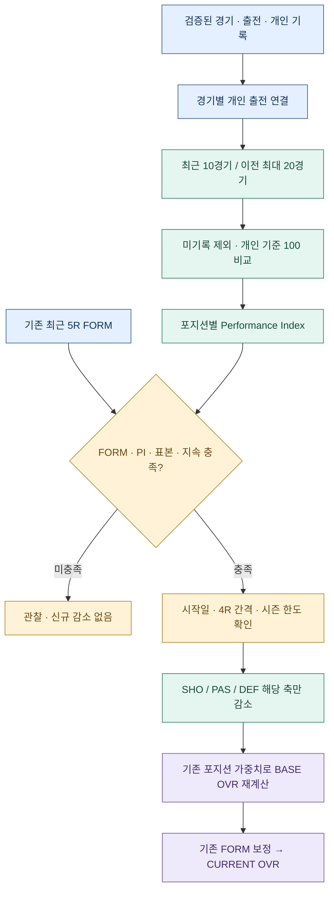

# GGFC V3.25.37 · 모바일 스와이프 지연 개선

V3.25.36을 기준으로 화면 계산의 중복 작업과 스와이프 중 계산으로 인한 멈춤을 줄였습니다. 경기기록, 능력치 산식·요율, 순위 및 베스트커플·DUO 선정 기준은 변경하지 않았습니다.

## 변경 내용

- 같은 화면을 한 번 그리는 동안 능력치 설정 병합, 날짜·선수명 정규화, 출석 검증, 선수별 라운드 집계 결과를 재사용합니다.
- 계산 캐시는 해당 동기 렌더링이 끝나면 즉시 폐기합니다. 날짜 조회, 설정 변경, DB 재업로드 시 오래된 계산 결과를 유지하지 않습니다.
- 손가락을 움직이는 동안(touchmove/touchend) 다음 메뉴의 무거운 계산을 시작하지 않습니다.
- 이미 방문하여 준비된 화면은 실제 화면을 손가락 위치에 맞춰 표시하고 재계산 없이 전환합니다.
- 처음 방문하는 미준비 화면은 메뉴명과 준비 표시가 함께 이동합니다. 손을 놓아 이동이 확정되고 전환 화면이 표시된 뒤 계산합니다. 짧게 밀었다가 취소하면 해당 메뉴는 계산하지 않습니다.
- 유휴 시간에도 Player Stats / Player Ratings / Player Analysis 등 무거운 메뉴를 자동 계산하지 않습니다. 가벼운 골레이로 랭킹·역대 운영진·역대 기록·공개 메뉴 없음 화면만 인접 메뉴일 때 미리 준비합니다.
- 데이터 갱신·저장·화면 크기 변경 시 기존 화면 미리보기는 무효화합니다. 공개 메뉴 순서·민감도·사용 여부·미저장 설정 보호는 그대로 따릅니다.

## 테스트 결과

실제 통합 기록지(4) 파일을 불러온 Chromium 모바일 화면(390×844)에서 측정한 첫 화면 계산 시간입니다. 휴대폰 실측이나 네트워크 다운로드 시간은 아니며 기기·DB 규모에 따라 달라집니다.

| 메뉴 | V3.25.36 | V3.25.37 |
|---|---:|---:|
| Player Stats | 약 1.89초 | 약 0.37초 |
| 골레이로 랭킹 | 약 0.008초 | 약 0.006초 |
| Player Ratings | 약 8.20초 | 약 0.88초 |
| Player Analysis | 약 2.89초 | 약 0.55초 |

골레이로 랭킹 자체는 원래도 가벼웠지만, 인접한 Player Ratings의 자동 사전 계산이 UI를 막을 수 있었습니다. 해당 사전 계산을 제한했습니다.

- 기본 DB와 능력치 설정·득점 기록 변경 후의 두 조건 모두에서 네 메뉴의 표시 텍스트가 기존 버전과 일치했습니다.
- Player Stats 66건, Player Ratings 390건의 서로 다른 능력치 조회 결과를 조건별로 직렬화하여 이전 버전과 비교했고 모든 필드가 일치했습니다.
- 화면 조회 전후 경기·출석·득점·SoccerBee·선수명단 DB가 동일함을 확인했습니다.
- 터치 첫 방문·재방문·취소·방향 전환·데이터 갱신·관리자 설정·가로/세로 스크롤·기기의 동작 줄이기 및 Chromium 실제 터치 입력을 검증했습니다.
- 이미지 미리보기와 신규 DB 파일은 배포 ZIP에 포함하지 않았습니다.

## 적용 방법

현재 V3.25.36 사용자는 **ggfc-record_V3.25.37_UPDATE_FROM_3.25.36.zip**을 풀어 기존 GitHub 저장소의 동일 경로에 덮어쓰면 됩니다.

교체 파일 7개:

1. index.html
2. mobile.html
3. assets/ggfc-app.js
4. assets/ggfc-mobile.js
5. assets/ggfc.css
6. service-worker.js
7. README.md

전체 파일이 필요하면 **ggfc-record_V3.25.37_LIGHT_FULL_36files.zip**을 사용하세요. 운영 중인 firebase-config.js 및 database.rules.json은 보존하세요. 이번 변경 파일 ZIP에는 두 파일이 없습니다.

업로드 후 기존 GGFC 탭과 설치형 앱 창을 모두 닫았다가 다시 열어, 화면 맨 아래 버전이 **3.25.37**인지 확인하세요. 이전 버전 창이 열려 있으면 정적 파일 캐시 업데이트가 대기할 수 있습니다. 엑셀 DB 재업로드는 필요하지 않습니다.

---

아래는 이전 버전의 변경 이력입니다. 현재 적용 파일과 방법은 위 V3.25.37 안내를 기준으로 합니다.

# GGFC V3.25.36 · 손가락을 따라 움직이는 모바일 메뉴 전환

V3.25.35 기준으로 모바일 좌우 스와이프를 연속 화면 전환으로 변경했습니다.

## 동작

- 화면의 일반 영역을 좌우로 밀면 현재 화면과 옆 메뉴의 실제 화면이 손가락 위치를 따라 함께 움직입니다.
- 현재 메뉴는 손을 놓고 이동이 확정될 때까지 유지합니다. 옆 화면은 미리보기 중 조작할 수 없습니다.
- 충분히 밀거나 빠르게 넘기면 옆 메뉴로 이동합니다. 짧게 천천히 밀거나 되돌리는 방향으로 손을 놓으면 원래 화면으로 돌아옵니다.
- 전환을 완료하면 다음 메뉴의 맨 위가 표시됩니다. 취소하면 기존 화면의 스크롤 위치를 유지합니다.
- 첫 메뉴에서 오른쪽, 마지막 메뉴에서 왼쪽으로 밀면 약한 저항만 보여주고 다른 끝으로 순환하지 않습니다.
- 관리자 메뉴 순서와 공개 여부를 따릅니다. 비공개 메뉴를 건너뜁니다.

## 기존 관리자 설정

관리자 → 메뉴 공개 관리 → 모바일 메뉴 스와이프의 사용 여부와 낮음/보통/높음 민감도를 그대로 사용합니다. 새 설정 저장이나 엑셀 변경은 필요하지 않습니다.

- 거리 기준: 보통 = 화면 너비의 18%, 최소 60px/최대 100px. 낮음 1.4배, 높음 0.7배.
- 빠른 넘기기: 최소 32px 이상 이동하고, 최근 이동 속도가 보통 기준 0.55px/ms를 넘으며 손을 놓는 방향과 일치할 때. 낮음·높음은 속도 기준에도 같은 배율을 적용합니다.
- 손을 놓은 뒤 이동·복귀 애니메이션은 남은 거리에 따라 약 160~300ms입니다.
- 기기의 '동작 줄이기' 설정이 켜져 있으면 손을 놓은 뒤 애니메이션을 생략합니다.
- 과거의 1.2초 이내 완료 조건은 제거했습니다. 천천히 길게 끌어도 화면을 따라 이동합니다.

## 조작 보호

세로 스크롤, 가로 스크롤이 있는 표/목록, 입력칸, 버튼, 링크, 선수 드래그, SVG/캔버스, CHEMISTRY MAP 조작을 우선합니다. 화면 가장자리 24px는 브라우저 기본 동작을 위해 남깁니다.

팝업/사이드바가 열려 있거나 미저장 설정·공유 저장·Team Squad 이미지 출력이 진행 중일 때 메뉴 스와이프를 막습니다. 두 손가락 조작, 화면 회전, 화면 크기 변경, 탭 비활성화, 데이터 갱신 및 다른 메뉴 선택 시 진행 중이던 미리보기를 정리합니다.

## 구현 범위

- 현재 메뉴 양옆만 유휴 시간에 준비하고, 같은 데이터에서 이미 준비한 화면을 재사용합니다.
- 처음 보는 메뉴라도 가능한 경우 실제 내용을 미리 표시합니다. 미리보기 렌더링에 실패하면 해당 방향의 이동을 확정하지 않습니다.
- DOM을 복제하지 않고 기존 화면을 사용하여 중복 ID/클릭 핸들러 복제 문제를 피합니다.
- 데이터 갱신·저장 시 준비된 화면을 무효화하여 다음 전환에 최신 기록을 사용합니다.
- 경기·순위·능력치·SoccerBee·FORM·DUO·팀 전력 계산 함수는 변경하지 않았습니다.
- V3.25.35의 사진/로고/테두리 관리자 설정 및 Team Squad 이미지 저장 기능을 포함합니다.

## 적용 방법

V3.25.35 사용자는 `ggfc-record_V3.25.36_UPDATE_FROM_3.25.35.zip`을 풀고 아래 8개 파일을 같은 경로에 덮어쓰세요.

- index.html
- mobile.html
- assets/ggfc-mobile.js
- assets/ggfc-app.js
- assets/ggfc-sync.js
- assets/ggfc.css
- service-worker.js
- README.md

전체 파일이 필요한 경우 `ggfc-record_V3.25.36_LIGHT_FULL_36files.zip`을 사용하세요. 운영 중인 firebase-config.js와 database.rules.json은 보존하세요.

배포 완료 후 새 버전 준비 알림을 확인하고, GGFC 탭을 모두 닫았다가 다시 접속하세요. 페이지 하단에서 V3.25.36을 확인할 수 있습니다. GitHub/Firebase에 자동 배포하거나 운영 데이터를 변경하지 않았습니다.

## 검증

브라우저에서 다음을 포함한 17개 항목을 확인했습니다.

- 실제 두 화면의 130px 추적, 메뉴 확정 시점 및 전환 후 스타일 정리
- 짧은 드래그 복귀, 진행 중 방향 반전, 터치 취소, 첫 메뉴 저항
- 스와이프 끄기, 세로 스크롤, 입력칸/가로 스크롤 보호
- 데이터 갱신과 사이드바 열기 시 취소
- Chromium의 실제 모바일 터치 이벤트 전달 경로
- 스크롤을 내린 상태에서 취소했을 때 기존 위치 유지
- 실제 통합 엑셀 DB를 사용한 회원 메뉴 준비 및 원본 경기/출석/득점/SoccerBee/선수명단 데이터 불변 확인
- 동작 줄이기와 브라우저 실행 오류 확인

테스트는 모바일 브라우저 에뮬레이션에서 수행했습니다. 실물 iPhone/Android 기기별 체감 성능까지 측정한 결과는 아닙니다.

---

아래는 이전 버전 변경 이력입니다.

# GGFC V3.25.35 · 관리자 화면 조절 · Team Squad 이미지 저장

V3.25.34를 기준으로 요청한 다섯 가지 기능을 추가했습니다.

## 1. 모바일 스와이프

관리자 로그인 → 메뉴 공개 관리 → 모바일 메뉴 스와이프에서 사용 여부와 민감도를 선택하고, 페이지 아래 설정 저장을 누르세요.

- 사용 여부: 켜기/끄기. 기본값은 켜기입니다.
- 민감도: 낮음/보통/높음. 기본값은 보통이며 이전 기준을 유지합니다.
- 보통의 최소 수평 이동거리 = 화면 너비의 18%, 최소 60px·최대 100px.
- 낮음은 보통 거리의 1.4배, 높음은 0.7배입니다. 예를 들어 390px 화면은 약 98/70/49px입니다.
- 기존 1.2초 제한, 세로 스크롤 판별, 가장자리 24px 보호 및 입력칸·버튼·그래프·가로 스크롤 표 제외 규칙을 유지합니다.
- 관리자 저장 후 회원에게도 적용됩니다. 설정을 편집하거나 이미지를 만드는 동안 스와이프 전환을 막습니다.

## 2. 감독·코치 사진 조절

관리자 로그인 → Team Squad → Team Squad 디자인 설정 · 관리자를 펼치세요.

- 사진 조정 대상에서 전체 팀 공통 또는 개별 팀을 선택합니다.
- 감독과 코치 각각 크기 60~150%, 좌우·상하 -30~+30px를 조절합니다.
- 100%는 기준 크기이고, +값은 오른쪽/아래로 이동합니다. 화면이 좁으면 사진을 가용 공간에 맞춰 비율대로 축소합니다.
- 공통 설정은 개별 설정이 없는 팀에 적용됩니다. 개별 팀을 처음 조절하면 당시 공통값을 복사하여 그 팀만의 설정을 만듭니다.
- '이 팀 사진을 공통 설정으로'는 해당 팀의 개별 설정을 해제합니다.
- 전체 공통 대상의 '전체 디자인 기본값'은 사진·배경 로고·테두리와 모든 팀별 조절값을 초기화하는 미리보기입니다. 저장 전에는 서버 기록이 바뀌지 않습니다.
- 변경은 아래 팀 상자에 즉시 미리 보입니다. 디자인 설정 저장으로 공유하며, 변경 취소는 저장된 값으로 돌아갑니다.
- 사진 원본은 기존 선수명단의 배경삭제 URL 선택 규칙을 유지합니다.

## 3. 배경 로고

같은 디자인 설정에서 전체 팀 공통으로 조절합니다.

| 항목 | 범위 | 기본값 |
|---|---|---|
| 배치 너비 | 상자 너비의 30~90% | 52% |
| 진하기 | 0~35% | 11% |

진하기 0%는 로고를 보이지 않게 합니다. 원래 이미지 비율을 유지하며 오른쪽에 배치합니다. 투명 여백이 많은 원본은 실제 그림 크기가 다르게 보일 수 있습니다.

## 4. 팀 고유 색상 테두리

기본적으로 팀별 색상 테두리를 사용합니다. 기존 프로그램의 Team Stats 색상을 초기값으로 재사용하며, 디자인 설정에서 팀마다 색상을 변경하거나 전체 색상 테두리를 끌 수 있습니다.

| 팀 | 초기 테두리 색상 |
|---|---|
| A특공대 | #7B2CBF |
| 풀파워 | #1976D2 |
| 어우씨 | #B8862B |
| D져스 | #42464D |
| 이지스 | #FF5F9E |
| F킬러 | #00A86B |

새 색상은 Team Squad의 상자와 그 출력 이미지에 적용됩니다.

## 5. Team Squad 공유 이미지

Team Squad → 이미지 저장 범위 → 전체 팀 또는 개별 팀 선택 → 필요하면 선수 명단 포함 → 공유 이미지 저장.

- 회원 열람모드에서도 현재 공개된 Team Squad 화면에서 저장할 수 있습니다.
- 선택한 스쿼드 변경일과 대회를 기준으로 이미지가 만들어집니다.
- 흰색 팀 상자, 전력, 별점, 팀 테두리, 배경 로고, 감독·코치 사진을 포함합니다.
- 선수 명단 포함 시 사진·이름·역할·포지션·CURRENT OVR·6개 기본 능력치를 요약 상자로 출력합니다. 화면의 카드 명단을 실제로 펼치거나 조회 날짜를 바꾸지 않습니다.
- 관리자 편집칸, 입력 컨트롤, 이동 이력, 버전/동기화 상태는 공유 이미지에서 제외합니다.
- 출력 기준 너비 1080px, 최대 배율 2배(2160px)입니다. 약 1,200만 화소·긴 변 16,000px를 넘지 않도록 자동 조절합니다. 과도하게 긴 명단은 팀별 저장을 안내합니다.
- 외부 사진 로딩 실패나 이미지 서버의 CORS 제한이 있으면 사진 대신 이름을 유지하고 알림을 표시합니다. 사진을 읽기 위한 대기 한도는 7초입니다.
- 저장된 PNG를 카카오톡에서 사진으로 첨부하면 됩니다. 카카오톡으로 자동 전송하지 않습니다.
- 관리자 디자인 미리보기 상태에서는 저장/취소를 먼저 안내합니다.

## 공유 저장 및 기존 기록

새 항목은 기존 DB.settings 안의 mobileSwipe와 squadAppearance에 저장합니다. 기존 Firebase 권한 검사를 사용하며, 미저장 디자인을 서버 수신으로 덮어쓰지 않도록 기존 설정 보호/미저장 JSON 내려받기/로그아웃 처리에 연결했습니다.

경기 기록, 순위, 능력치, 성장, FORM, DUO, 팀 전력 및 별점의 계산 공식은 변경하지 않았습니다. 엑셀 양식 변경도 필요하지 않습니다.

## 적용 방법

V3.25.34 사용자는 `ggfc-record_V3.25.35_UPDATE_FROM_3.25.34.zip`의 아래 9개 파일을 동일 경로에 덮어쓰세요.

- index.html
- mobile.html
- assets/ggfc-app.js
- assets/ggfc-mobile.js
- assets/ggfc-squad.js
- assets/ggfc-sync.js
- assets/ggfc.css
- service-worker.js
- README.md

전체 파일은 `ggfc-record_V3.25.35_LIGHT_FULL_36files.zip`입니다. 운영 중인 firebase-config.js와 database.rules.json은 보존하세요.

GitHub Pages 배포 완료 후 새 버전 준비 알림을 확인하고, GGFC 탭을 모두 닫은 뒤 다시 접속하세요. 페이지 하단에서 V3.25.35를 확인할 수 있습니다. 운영 사이트에는 자동 배포하지 않았습니다.

## 검증

브라우저에서 설정 미리보기/저장/취소, 공통·팀별 적용, DB 직렬화 왕복, 회원 설정 제한, 스와이프 켜기/끄기와 3단계 거리, 세로 제스처 보호, 320/390/1440px 가로 넘침, 팀별 및 전체 6팀 PNG, 선수 명단 포함, 출력 실패 후 정리와 버튼 복구 등 18개 확인 항목을 통과했습니다.

테스트 데이터와 통제된 투명 사진을 사용했습니다. 실제 운영 Firebase로 변경 내용을 전송하거나 외부 사진 서버의 가용성을 검증한 것은 아닙니다. 새 관리자 기능은 기존 인증·연결 검사를 통과해야 저장할 수 있습니다.

---

아래는 이전 버전 변경 이력입니다.

# GGFC V3.25.34 · Team Squad 흰색 배경과 팀 로고

V3.25.33 기준으로 Team Squad의 팀 상자 디자인을 변경했습니다.

## 적용 내용

- 각 팀 상자와 상단 정보 영역의 배경을 흰색으로 변경했습니다.
- 해당 팀의 기존 로고를 오른쪽 배경에 크게 배치했습니다. 배치 영역은 상자 너비의 52%이며, 로고의 원래 비율을 유지합니다.
- 배경 로고는 11% 불투명도로 표시하고, 팀명·감독·코치·전력 수치를 그 위에 배치했습니다.
- 배경 로고는 팀 상단 정보 영역 안에 고정되어 선수 명단을 펼쳐도 크기가 늘어나지 않습니다.
- 로고가 없거나 읽기에 실패하면 장식 이미지를 숨깁니다.
- 선수 능력치, 팀 전력, 별점, 기록 집계와 Firebase 동기화 로직은 변경하지 않았습니다.

## 적용 방법

V3.25.33 사용자는 `ggfc-record_V3.25.34_UPDATE_FROM_3.25.33.zip`의 6개 파일을 기존 경로에 덮어쓰세요.

- index.html
- mobile.html
- assets/ggfc-squad.js
- assets/ggfc.css
- service-worker.js
- README.md

전체 파일이 필요한 경우 `ggfc-record_V3.25.34_LIGHT_FULL_36files.zip`을 사용하세요. 운영 중인 firebase-config.js와 database.rules.json은 보존하세요.

GitHub Pages 배포가 끝나면 새 버전 준비 알림을 확인하고 GGFC 탭을 모두 닫은 뒤 다시 접속하세요. 페이지 하단에서 V3.25.34를 확인할 수 있습니다.

## 확인 범위

PC 1440px 및 모바일 390px·320px에서 팀 상자의 흰색 배경, 오른쪽 배경 로고 배치 및 가로 넘침을 확인했습니다. 화면 확인에는 구분 가능한 테스트 로고와 스쿼드 데이터를 사용했습니다. 원본 팀 로고의 투명 여백에 따라 실제 그림이 차지하는 크기는 달라질 수 있습니다.

JavaScript 문법과 정적 파일 캐시의 해시를 확인했습니다. 운영 사이트에는 자동 배포하지 않았습니다.

---

아래는 이전 버전 변경 이력입니다.

# GGFC V3.25.33 · 화면 하단 상태 표시 · Team Squad · 모바일 스와이프

V3.25.32를 기준으로 요청한 화면과 메뉴 이동 방식을 수정했습니다.

## 적용 내용

1. **페이지 하단 상태 표시**
   - 프로그램 버전과 공유 기록 상태를 모든 페이지 본문 뒤의 공통 하단 영역으로 이동했습니다.
   - 공유 저장 재시도·미저장 내용 내려받기·서버 기록 다시 받기 버튼도 같은 영역에서 사용할 수 있습니다.
   - 상태 메시지 갱신, 캐시 기록 표시, Firebase 연결·저장 방식은 유지합니다.

2. **Team Squad 팀 상자**
   - 남색 팀 헤더를 밝은 회색으로 변경하고 글자·별점·막대 배경의 대비를 조정했습니다.
   - 감독·코치 사진 영역의 가로·세로를 각각 50% 확대했습니다. 인물의 종횡비는 유지합니다.
   - 사진 뒤의 배경, 테두리, 그림자와 이름표의 배경을 제거했습니다. 팀스쿼드 감독·코치 및 선수명단의 배경삭제 사진 URL을 사용하는 기존 규칙은 유지합니다.
   - 확대된 사진이 잘리지 않도록 공간이 부족하면 사진 영역을 아래로 배치합니다. 모바일에서는 좁은 화면에 맞춰 두 사진을 일부 겹칩니다.
   - 투명 사진 뒤로 대체 이니셜이 비치지 않도록 처리했습니다. 사진이 없거나 최종 로딩에 실패하면 대체 이니셜과 이름을 표시합니다.
   - 공격·중앙·수비 막대는 넓은 화면에서 나란히 배치하고 아주 좁은 화면에서는 세로로 배치합니다.

3. **Team Squad 조회·설명**
   - 대회와 스쿼드 변경일 선택 항목을 같은 줄에 나란히 배치했습니다. 각 항목의 이름과 선택창은 위아래로 정렬합니다.
   - ‘팀 전력과 별점 계산 기준’은 관리자 모드에서만 표시합니다.
   - 스쿼드 조회일, 전력, 별점의 산정 방식은 변경하지 않았습니다.

4. **모바일 메뉴**
   - 화면 맨 아래의 모바일 메뉴를 제거하고 이를 위해 비워 두었던 하단 공간을 줄였습니다.
   - 상단 메뉴와 삼선 버튼은 그대로 사용할 수 있습니다.
   - 본문의 일반 영역을 왼쪽으로 밀면 다음 메뉴, 오른쪽으로 밀면 이전 메뉴로 이동합니다.
   - 관리자가 정한 사이드바 메뉴 순서를 따릅니다. 열람모드에서는 비공개 메뉴를 건너뛰고, 관리자 모드에서는 관리자에게 허용된 메뉴를 사용합니다.
   - 첫 메뉴와 마지막 메뉴에서는 멈추며 반대쪽 끝으로 순환하지 않습니다.
   - 표의 가로 스크롤, 그래프·SVG·캔버스, 링크·버튼·입력칸·선수 드래그 등의 조작은 우선 보존합니다. 사진 팝업·로그인 창·사이드바가 열려 있거나 공유 저장 및 설정 변경이 대기 중이면 스와이프 전환을 막습니다.
   - 세로 스크롤, 짧은 터치, 두 손가락 제스처는 메뉴 전환으로 처리하지 않습니다. 화면 양 끝 24px에서는 브라우저 기본 가장자리 동작을 보존합니다.

## 사진 크기

아래는 사진을 담는 CSS 영역의 크기입니다. 원본 투명 여백에 따라 실제 인물 크기는 다르게 보일 수 있습니다.

| 화면 | 역할 | 이전 → 변경 |
|---|---|---|
| PC | 감독 | 150.8×195 → 226.2×292.5 |
| PC | 코치 | 127.4×169 → 191.1×253.5 |
| 760px 이하 | 감독 | 114.4×145.6 → 171.6×218.4 |
| 760px 이하 | 코치 | 98.8×130 → 148.2×195 |

## 적용 방법

**V3.25.32 사용자:** `ggfc-record_V3.25.33_UPDATE_FROM_3.25.32.zip`을 풀고 아래 7개 파일을 같은 경로에 덮어쓰세요.

- `index.html`
- `mobile.html`
- `assets/ggfc-app.js`
- `assets/ggfc-mobile.js`
- `assets/ggfc.css`
- `service-worker.js`
- `README.md`

전체 파일이 필요하면 `ggfc-record_V3.25.33_LIGHT_FULL_36files.zip`을 사용하세요. 운영 중인 `firebase-config.js`와 `database.rules.json`은 보존하세요. 기존 파일을 삭제할 필요는 없습니다.

변경 파일을 함께 올리고 GitHub Pages 배포 완료를 기다리세요. V3.25.32부터 정적 파일 캐시가 있으므로, 새 버전 준비 알림이 나오면 저장을 마친 후 **GGFC 탭을 모두 닫고 다시 접속**하세요. 본문 맨 아래에서 V3.25.33을 확인할 수 있습니다. 일반 새로고침만으로 대기 중인 업데이트가 적용되지 않을 수 있습니다.

운영 GitHub/Firebase에 자동 업로드하거나 실데이터를 수정하지 않았습니다.

## 검증 범위

- 실제 통합 DB의 팀 스쿼드·팀 전력·선수 능력치 모델을 이전 버전과 비교했습니다.
- PC와 모바일 사진의 가로·세로 1.5배 비율, 투명 배경·테두리 제거, 조회 필터 같은 줄 배치 및 320/390/760/820/1024/1440px 화면의 가로 넘침을 확인했습니다.
- 실제 브라우저 터치 이벤트로 좌우 메뉴 이동, 메뉴 순서·공개 여부 반영, 세로·짧은 터치 제외, 표 가로 스크롤 우선 처리, 팝업과 설정 변경 중 이동 차단을 확인했습니다.
- 회원 메뉴의 하단 상태 위치와 PC·모바일 사이드바 동작, 관리자 설명 표시를 확인했습니다.
- 사진 배치 검증에는 통제된 투명 이미지를 사용했습니다. 외부 사진 서버의 실제 가용성을 보장하는 검증은 아닙니다.
- 계산 함수·사진 선택 규칙·Firebase 동기화·고해상도 이미지 출력 함수는 이번 변경에 포함하지 않았습니다.

---

아래는 이전 버전 변경 이력입니다.

# GGFC V3.25.32 · Loading Optimization

V3.25.31을 기준으로 로딩·캐시 계층만 개선했습니다. 선수 능력치·성장·FORM·SLUMP, 승점·순위, 베스트커플·DUO, 카드·메뉴·출력 디자인의 계산 및 기능 코드는 변경하지 않았습니다.

## 달라진 로딩 순서

1. 로컬 프로그램을 준비하고, 이전에 받은 동일 Firebase 프로젝트의 기록이 있으면 즉시 표시합니다.
2. ‘최근 기록 표시 중 · 최신 데이터 확인 중…’ 상태에서 Firebase 라이브러리와 최신 기록을 백그라운드로 불러옵니다.
3. 최신 기록 수신 후 기존 실시간 동기화 방식으로 화면을 갱신합니다.
4. 캐시가 없는 첫 방문은 정상적인 서버 수신을 기다립니다. 캐시 손상·저장공간 부족 시에도 서버 읽기는 계속 진행합니다.

기존 12초 타이머는 캐시를 표시하기 위한 대기 시간이 아니라 연결 지연 안내로만 사용합니다. Firebase SDK 버전은 기존 10.12.2, DB 경로는 기존 `ggfc/v3`입니다. DB 구조나 보안 규칙을 변경하지 않습니다.

## 적용한 최적화

| 항목 | 적용 내용 |
|---|---|
| 기록 캐시 | 기존 프로젝트별 localStorage 캐시를 최초 표시부터 사용하고 서버에서 갱신합니다. 관리자 저장이 성공한 최신 값도 캐시에 반영합니다. |
| Firebase 로딩 | SDK 3개가 HTML 파싱과 캐시 기록 표시를 막지 않도록 백그라운드에서 기존 순서대로 불러옵니다. |
| 이미지 저장 | HTML의 html2canvas 선행 다운로드를 제거했습니다. 기존 이미지 저장 시점의 Lazy Loader를 그대로 사용합니다. |
| 정적 파일 캐시 | Service Worker가 HTML·CSS·JS·로컬 SVG·폰트 29개를 검증해 보관합니다. 재접속 시 이 파일들을 재사용합니다. |
| 파일별 버전 | 변경하지 않은 파일의 `?v=3.25.31`은 유지합니다. 동기화·캐시 로더만 `?v=3.25.32`입니다. |
| 배포 안정성 | SHA-256이 맞는 전체 정적 파일이 준비된 경우에만 새 캐시가 설치됩니다. 업데이트 중 기존 캐시와 해시가 동일한 파일은 다운로드 없이 재사용합니다. |

Firebase 데이터·인증 요청, 외부 선수 사진, 외부 라이브러리는 Service Worker 캐시 대상에 넣지 않습니다. `firebase-config.js`는 서버 우선 확인, 실패 시 이전에 저장된 설정을 사용합니다. 설정은 일반 정적 파일과 다르게 독립 갱신됩니다.

첫 방문에는 캐시를 만드는 다운로드가 발생합니다. 재방문 때 효과가 크며, 기기 성능·네트워크·DB 크기에 따라 속도는 달라집니다. 캐시가 지워진 기기는 다시 최초 접속 과정을 거칩니다. 이미지 저장용 외부 라이브러리, 로그인 및 최신 기록 수신에는 인터넷 연결이 필요합니다.

기능 JS 분할 Lazy Loading과 Firebase 화면별 분리 수신은 적용하지 않았습니다. 의존성과 계산 흐름을 그대로 유지하기 위한 범위 선택입니다.

## 관리자 저장 보호

- 캐시를 표시해도 서버 수신 완료 상태로 취급하지 않습니다.
- 인증·최신 서버 수신·연결 상태가 확인되기 전에는 편집과 저장을 허용하지 않습니다.
- 기존 revision 트랜잭션과 충돌 검사를 유지합니다. 편집 중 다른 관리자의 변경이 오면 미저장 내용을 덮어쓰지 않습니다.
- 서버 기록이 비어 있으면 오래된 캐시도 비웁니다. 캐시를 서버에 자동 업로드하지 않습니다.
- 새 프로그램이 준비되어도 열린 화면을 강제로 새로고침하지 않습니다. 저장을 마치고 GGFC 탭을 모두 닫았다가 다시 열면 준비된 업데이트가 적용됩니다.

Service Worker를 사용할 수 없는 환경에서도 기존 HTTP 로딩 방식으로 실행합니다. 캐시는 HTTPS(GitHub Pages) 또는 localhost에서 동작하며, ZIP을 풀어 `file://`로 여는 방식에서는 활성화되지 않습니다.

## 적용 방법

**현재 V3.25.31이면 변경 파일 ZIP을 권장합니다.**

`ggfc-record_V3.25.32_UPDATE_FROM_3.25.31.zip`의 아래 7개 파일을 같은 경로에 덮어쓰세요. 삭제할 기존 파일은 없습니다.

- `index.html`
- `mobile.html`
- `assets/ggfc-sync.js`
- `assets/ggfc-cache.js` (신규)
- `service-worker.js` (신규, index.html과 같은 위치)
- `tools/build-static-cache.py` (신규, 향후 배포 파일 생성용)
- `README.md`

다른 버전이거나 전체 파일이 필요하면 `ggfc-record_V3.25.32_LIGHT_FULL_36files.zip`을 사용하세요. 기존 운영용 `firebase-config.js`와 `database.rules.json`은 보존하세요. 이번 업데이트에서 두 파일의 내용은 변경하지 않았고 변경 파일 ZIP에도 포함하지 않았습니다.

가능하면 전체 변경 파일을 한 번의 GitHub 커밋으로 업로드하고 Pages 배포 완료를 기다리세요. 처음 교체한 뒤 강력 새로고침으로 상단 V3.25.32를 확인하세요. 정적 캐시 설치가 끝난 다음 접속부터 캐시가 사용됩니다. 이후 업데이트 알림이 보이면 저장을 마치고 GGFC 탭을 모두 닫았다가 다시 여세요. 탭을 유지한 일반 새로고침만으로는 대기 중인 새 버전이 적용되지 않을 수 있습니다.

이 패키지는 배포 준비본입니다. 운영 GitHub/Firebase에 자동 배포하거나 실데이터를 저장하지 않았습니다.

## 다음 업데이트의 파일 관리

이번 제공본은 이미 캐시 목록을 생성했으므로 별도 명령을 실행할 필요가 없습니다.

소스를 직접 수정하는 관리자는 수정 완료 후 아래 명령으로 HTML의 파일별 버전과 검증용 Service Worker를 다시 생성하세요.

```bash
python3 tools/build-static-cache.py --version 3.25.33
```

- 바뀐 JS/CSS의 버전만 갱신합니다. 변경하지 않은 파일의 URL은 유지합니다.
- 생성된 HTML, `service-worker.js`, 실제 수정 파일을 함께 배포합니다.
- Service Worker를 수동 편집하거나 파일만 수정하고 캐시 목록을 재생성하지 않으면 다음 캐시 설치가 거부될 수 있습니다. 기존에 정상 설치된 버전은 유지됩니다.
- 기본 기능 파일명은 계속 동일하게 유지하며, 구버전 JS 복사본을 추가하지 않습니다.

## 검증과 한계

26개 브라우저 검증을 통과했습니다.

- 실제 통합 DB: 282경기·4,106건의 참석 기록, 명단에 나타나는 70개 선수명의 능력치 및 선수 누적 통계가 V3.25.31과 일치했습니다.
- Firebase SDK 응답을 2.5초 늦춘 테스트에서도 SDK 준비 전에 캐시 기록이 먼저 표시됐습니다. 로컬 Chromium 테스트에서는 약 0.7초 수준이었으며 실제 휴대폰 성능을 보장하는 수치는 아닙니다.
- 캐시만 받은 상태의 관리자 저장 차단, 최신 서버 수신, 관리자 저장 후 캐시 갱신, 동시 편집 충돌 보호, 서버 삭제 반영, 손상 캐시·저장공간 오류·연결 오류를 확인했습니다.
- GitHub Pages와 같은 하위 경로에서 정적 캐시 설치·재접속·모바일 캐시 페이지, 업데이트 대기·적용, 변경하지 않은 파일 재사용, 불완전 배포 거부 및 이전 정상 버전 유지를 확인했습니다.
- 종합기록 이미지 저장은 기존 12대진, 2568×12804px 결과를 유지했습니다. 출력 높이는 선택 경기일에 따라 달라집니다.
- 모든 JS 구문 검사를 통과했고 테스트 중 브라우저 스크립트 오류는 없었습니다.
- Firebase 연결·인증·저장·충돌은 모의 서버로 검증했습니다. 실제 운영 서버와 여러 실사용 휴대폰을 동원한 부하 테스트는 수행하지 않았습니다.

설계 참고: [Service Worker 수명 주기](https://web.dev/articles/service-worker-lifecycle), [Firebase 웹 읽기·쓰기](https://firebase.google.com/docs/database/web/read-and-write).

---

아래는 이전 버전 변경 이력입니다. 이전 배포 파일명·검증 수치는 해당 버전의 기록입니다.

# GGFC V3.25.31 · 종합기록 대진 로고·텍스트 확대

## 변경 사항

Overview에서 저장하는 종합기록 이미지에만 적용합니다.

| 요소 | 이전 → 변경 | 배율 |
|---|---|---|
| 상단 팀별 요약 상자의 팀 로고 | 34×34 → 68×68 | 가로·세로 2배 |
| 각 대진의 팀 로고 | 23×29 → 34.5×43.5 | 가로·세로 1.5배 |
| 대진 팀명 글씨 | 9 → 13.5 | 1.5배 |
| 대진 아래 득점자 글씨 | 7 → 10.5 | 1.5배 |

위 수치는 출력 레이아웃의 CSS 단위입니다. 기존 출력 배율을 먼저 계산한 뒤 대진 영역만 확대하므로, 높이에 맞춘 자동 축소가 확대 효과를 상쇄하지 않습니다. 실제 화면상 크기를 이전 버전과 비교해 배율을 확인했습니다.

- 양쪽 대진의 행 높이를 맞춥니다. 확대된 로고의 원본 종횡비는 보존합니다.
- 출력 폭은 기본 2568px(6배 렌더링)로 유지합니다. 높이는 대진·득점자 수에 맞게 늘어나며, 한 장으로 저장합니다.
- 실제 DB의 2026-10-16 경기일 검증 결과는 2568×12804px입니다. 모든 경기일의 높이가 이 값으로 고정되는 것은 아닙니다.
- 상단 3개 팀 상자의 공간이 부족한 특수 조회에서는 상자가 다음 행으로 배치되어 로고가 겹치지 않게 합니다.
- 일반 Overview 화면, Team Squad 화면, 랭킹 글씨 크기, 경기 데이터·계산식은 변경하지 않았습니다.
- V3.25.30의 출석률 정수 표시, 넓어진 랭킹 표 간격, 조회기간 문구, 리그별 금메달 및 사이드바·Team Squad 변경은 유지합니다.

## 적용 방법

V3.25.30 사용자는 `ggfc-record_V3.25.31_UPDATE_FROM_3.25.30.zip`의 아래 5개 파일을 동일 경로에 덮어쓰세요.

- `index.html`
- `mobile.html`
- `assets/ggfc-app.js`
- `assets/ggfc-export.css`
- `README.md`

전체 33개 파일은 `ggfc-record_V3.25.31_LIGHT_FULL_33files.zip`입니다. 기존 Firebase 설정을 보존하세요. 교체 후 Ctrl+Shift+R로 강력 새로고침하고 V3.25.31 표기를 확인하세요. 운영 GitHub/Firebase에는 자동 배포하지 않았습니다.

## 검증

실제 통합 기록지를 이전 버전과 새 버전에 동일하게 적용했습니다. 로고 실측 가로·세로 배율, 글씨 실효 크기, 랭킹 크기 유지, 12개 대진 보존, 양쪽 행 정렬, 영역 잘림·가로 넘침 방지, 고해상도 PNG, 반복 렌더링 안정성, 득점자 15명 상황, 모바일과 PC의 동일 출력 배치 등 18개 검증 항목을 통과했습니다.

---

아래는 이전 버전 운영 안내입니다. 버전명·배포 파일명·고정 출력 높이는 당시 변경 이력입니다.

# GGFC V3.25.30 · 출력 이미지·사이드바·Team Squad 개선

## 1. Overview 출력 이미지

- 출석률은 출력할 때만 반올림해 정수 %로 표시합니다. 예: 90.9% → 91%, 81.8% → 82%. 원래 계산값·순위·일반 Overview 표의 소수점은 변경하지 않습니다.
- 출석·득점·도움 랭킹 사이 간격을 8 → 12 레이아웃 단위로 50% 늘렸습니다. 각 표의 열 너비를 비율로 배분해 균형을 맞췄습니다.
- 랭킹 위 ‘순위 집계 기준’ 제목과 상세 설명을 출력 이미지에서 제외하고, 굵은 조회기간 문구만 남겼습니다. Overview 화면의 관리자용 설명은 유지합니다.
- 상단 구간 팀순위에서 슈퍼리그·챌린지리그 각각 1위는 금메달을 표시합니다. 하단 누적 팀순위의 왕관과 1위 강조 배경은 유지합니다.
- PNG 크기는 2568×12282px이며, 기기 한계로 생성에 실패하면 1712×8188px로 재시도합니다.

## 2. 사이드바

- PC·모바일 모두 접속하거나 새로고침할 때 기본 숨김입니다. 과거에 저장된 ‘열림’ 설정은 초기 표시를 바꾸지 않습니다.
- 좌측 상단 삼선 버튼으로 열 수 있습니다. PC는 삼선 버튼을 다시 누르거나 닫기·Escape로 닫을 수 있습니다.
- 모바일은 기존 닫기·배경 클릭·Escape와 초점 이동을 유지합니다. 메뉴를 선택하면 사이드바가 닫힙니다.

## 3. Team Squad

- 팀명 아래 스쿼드 적용일·능력치 기준일·인원 주석은 관리자 모드에서만 표시합니다.
- 감독·코치는 팀스쿼드의 담당자를 사용하며, 사진은 선수명단의 ‘사진(URL) 배경삭제’에서 가져옵니다. 기존 선수명단 연도 선택 규칙을 재사용합니다.
- 배경삭제 사진이 없거나 불러오기에 실패하면 이름 이니셜을 표시합니다. 일반 ‘사진(URL)’로 자동 전환해 흰 배경이 다시 나오는 상황을 피했습니다.
- 사진 영역은 가로·세로 각각 30% 확대했습니다. `object-fit: contain`으로 원본 종횡비를 보존합니다.
- 팀 로고도 가로·세로 각각 30% 확대했습니다. 사진·팀명·능력치 막대가 겹치지 않도록 좁은 화면에서는 영역을 다음 줄로 배치합니다.

| 요소 | PC 이전 → 변경 | 모바일 이전 → 변경 |
|---|---|---|
| 감독 사진 | 116×150 → 150.8×195 | 88×112 → 114.4×145.6 |
| 코치 사진 | 98×130 → 127.4×169 | 76×100 → 98.8×130 |
| 팀 로고 | 102×124 → 132.6×161.2 | 72×88 → 93.6×114.4 |

위 크기는 CSS 픽셀입니다. 원본 이미지의 투명 여백이 넓으면 실제 인물은 영역보다 작게 보일 수 있습니다.

## 4. 적용 파일

V3.25.29에서 `ggfc-record_V3.25.30_UPDATE_FROM_3.25.29.zip`의 아래 8개 파일을 같은 경로에 덮어쓰세요.

- `index.html`
- `mobile.html`
- `assets/ggfc-app.js`
- `assets/ggfc-mobile.js`
- `assets/ggfc-squad.js`
- `assets/ggfc.css`
- `assets/ggfc-export.css`
- `README.md`

전체 버전은 `ggfc-record_V3.25.30_LIGHT_FULL_33files.zip`입니다. 기존 Firebase 설정은 보존하세요. 경기 DB·능력치·승점·SLUMP 계산식은 수정하지 않았습니다. 교체 후 강력 새로고침(Ctrl+Shift+R)으로 V3.25.30을 확인하세요. 운영 GitHub/Firebase에는 자동 배포하지 않았습니다.

## 5. 검증

실제 통합 기록지를 가져와 출력 이미지와 일반 화면을 비교했습니다. 정수 % 표시, 12 단위 표 간격, 기간 문구만 출력, 리그별 금메달, PNG 실해상도·내용 잘림·DB 비변경을 검증했습니다. PC와 모바일의 사이드바 열기·닫기·재접속, 관리자 전환에 따른 주석 표시, 배경삭제 열 선택, 사진·로고 130% 크기 및 1440/1024/820/390px 화면 배치를 확인했습니다. 외부 사진 서버의 실제 가용성 대신 제어된 이미지로 로딩·레이아웃을 확인했습니다.

---

아래는 이전 버전 운영 안내입니다. 버전명·배포 파일명은 당시 변경 이력입니다.

# GGFC V3.25.29 · Overview 랭킹·종합기록 이미지 개편

## 적용 내용

1. 첫째 줄을 출석랭킹 → 득점랭킹 → 도움랭킹으로 배치했습니다. 세 표의 소속 팀 열을 제거했습니다. 출석률 계산의 분모인 ‘팀 경기’ 열은 유지했습니다.
2. 둘째 줄을 팀순위 → 개인순위 → 파울순위로 배치했습니다. 작은 모바일 화면에서는 같은 순서로 세로 배치합니다. 종합기록 이미지는 화면 크기와 관계없이 3열×2행으로 출력합니다.
3. 세 랭킹은 최대 20명까지 표시하며, 남은 대상 선수가 있을 때만 20번째 선수 이름 뒤에 ‘외 N명’을 표시합니다. N은 동점 인원이 아니라 해당 랭킹의 20명 외 전체 대상 인원입니다. 20명 이하면 문구를 표시하지 않습니다.
4. 관리자 로그인 시 최신 경기 기록 시즌의 하반기 전체를 랭킹·상대전적의 기본 조회기간으로 적용합니다. 로그인 후 직접 선택한 기간은 일반적인 화면 갱신이나 동일 인증 상태 갱신으로 초기화하지 않습니다. 재로그인하면 하반기 전체로 돌아갑니다. 기간을 바꾸면 실제 선택 범위에 맞춰 안내문도 바뀝니다.
5. 기존 누적 팀순위의 주석을 첫째 줄 랭킹 위의 별도 안내 상자로 이동했습니다. 주석은 기존대로 관리자 화면에 표시하며, 기간 표시는 회원도 볼 수 있습니다. 예: ‘2026년 하반기 전체 라운드 누적 기록 · 1R~11R · 132경기 · 등록된 경기 기준’. 아직 열리지 않은 미래 라운드의 성적이 포함된다는 뜻은 아닙니다. 이미지에도 집계 기준과 조회기간을 표시합니다.
6. 이미지의 구간 팀순위와 누적 팀순위 상자를 짙은 남색 테두리로 강조하고, 1위 행에 금색 배경과 왕관을 적용했습니다. 누적 팀순위의 공동 1위는 모두 왕관을 표시합니다. 순위 계산식 자체는 그대로입니다.

## 랭킹 계산 기준

| 항목 | 대상 | 정렬 | 외 N명 |
|---|---|---|---|
| 출석랭킹 | 조회기간에 참가 가능한 팀 경기가 있는 선수 | 출석률 내림차순 → 이름순; 동일 출석률 공동순위 | 대상 선수 수 − 20 |
| 득점랭킹 | 조회기간 득점 1개 이상 | 득점 내림차순 → 출전 경기 수 오름차순 → 이름순 | 득점 대상 선수 수 − 20 |
| 도움랭킹 | 조회기간 도움 1개 이상 | 도움 내림차순 → 출전 경기 수 오름차순 → 이름순 | 도움 대상 선수 수 − 20 |

‘외 N명’은 0보다 클 때만 표시합니다. 도움은 기존 검증된 경기기록의 도움 합계(`a`)를 사용하며 키패스를 도움으로 변환하지 않습니다. 선수 이름 클릭 시 기존과 동일한 조회기간의 선수카드가 열립니다.

기존 상단 ‘팀 순위 및 누적 기록’의 구간 조회는 하단 랭킹 조회와 독립적으로 유지됩니다. 관리자 기본 하반기 조회에 기록이 없으면 빈 표가 표시됩니다. 열람모드의 랭킹은 기존대로 최신 경기의 해당 반기 기준입니다.

## 유지한 V3.25.28 변경

- 각 대진에 슈퍼리그·챌린지리그·인터리그 등 경기 구분 표시
- 모든 출력 표 제목 행의 짙은 남색·흰색 굵은 글씨
- PNG 기본 2568×12282px, 캔버스 생성 실패 시 1712×8188px로 재시도
- 원본 로고 종횡비 유지, 출력 전용 배치로 일반 화면에 영향 방지

## 파일 적용

V3.25.27 또는 V3.25.28 사용자는 `ggfc-record_V3.25.29_UPDATE_FROM_3.25.27_OR_28.zip`의 6개 파일을 동일 경로에 덮어쓰면 됩니다.

- `index.html`
- `mobile.html`
- `assets/ggfc-app.js`
- `assets/ggfc.css`
- `assets/ggfc-export.css`
- `README.md`

전체 33개 파일은 `ggfc-record_V3.25.29_LIGHT_FULL_33files.zip`에 들어 있습니다. 기존 프로젝트의 Firebase 설정은 보존하세요. `firebase-config.js`, `database.rules.json`, `assets/ggfc-sync.js`, `assets/ggfc-slump.js` 등 나머지 파일은 기존 V3.25.27과 동일합니다.

교체 후 강력 새로고침(Ctrl+Shift+R)을 실행하고 상단 V3.25.29 표기를 확인하세요. 운영 GitHub/Firebase에는 자동 배포하지 않았습니다.

## 검증

실제 통합 기록지(경기 282개, 참석 4106행)를 사용했습니다. 기본 하반기 기준 출석 대상 66명/득점 대상 57명/도움 대상 38명으로 ‘외 46명/37명/18명’을 확인했습니다. 0·19·20·21·23명 경계, 조회기간 전환·재로그인, 상단 팀순위 독립 유지, 화면과 출력 수치 일치, 왕관, 2568×12282px 저장, 출력 영역 잘림 여부, 모바일 가로 넘침 및 브라우저 오류를 확인했습니다. 계산 DB와 기존 능력치·SLUMP 엔진은 변경하지 않았습니다.

---

아래는 이전 V3.25.27 운영 안내입니다. 아래 버전명과 당시 배포 파일명은 이전 변경 이력입니다.

# GGFC V3.25.27 · LONG FORM / SLUMP 구현·운영 보고서

작성 기준: V3.25.26 최종 Full, 「붙여넣은 텍스트(1).txt」 요구사항, DB GGFC_통합_기록지_역대기록(4).xlsx.

## 먼저 확인할 운영 사항

**요청한 기본 설정을 유지하면 신규 SLUMP 감점은 발생하지 않습니다.** 구현 오류가 아니라 기존 FORM 산식과 지속 조건의 조합에 따른 결과입니다.

기존 FORM의 최근 5R 중 4R 연속 출전 시 출석 가산은 최소 +0.8입니다. 경기성과 최솟값은 −1.5이고 연속결석 벌점은 0이므로 원점수 최솟값은 `+0.8−1.5=−0.7`, 반올림한 FORM은 **−1**입니다. 따라서 **FORM ≤−2 AND 출전 4R 연속**은 기본 FORM에서 충족할 수 없습니다. 본 버전은 결석을 부진 지속의 증거로 세지 않는 보수적인 구현입니다.

- 기본값 −2와 기존 FORM 계산은 그대로 보존했습니다.
- 관리자에서 FORM Trigger를 **−1**로 변경할 수 있습니다. 이 경우에도 PI≤75, 표본, 출전 4R 지속, 개별 축 기준을 모두 충족해야 감점합니다. −1이 곧바로 감점을 뜻하지 않습니다.
- 이번 파일의 기본값을 임의로 −1로 바꾸지 않았습니다. 우선 비교 지표와 자료 충실도를 확인하는 용도로 사용할 수 있습니다.
- 신규 적용 시작일 기본값은 **2026-10-20**입니다. 시작일 이전 기존 LONG FORM 조정은 유지하고, 이후 기존 방식과 새 방식을 중첩하지 않습니다.
- 회복 Story는 기본 **OFF**입니다. 부진 내용을 회원 Story로 강제 노출하지 않습니다.

## 1. 버전과 수정 파일

| 항목 | 내용 |
|---|---|
| 이전 버전 | V3.25.26, 그대로 보존 |
| 새 버전 | V3.25.27 |
| 전체 ZIP | `ggfc-record_V3.25.27_LIGHT_FULL_33files.zip` · 33개 파일 |
| 교체 ZIP | `ggfc-record_V3.25.27_UPDATE_FROM_3.25.26.zip` · 6개 파일 |
| 배포 여부 | 파일 생성·로컬 검증 완료. GitHub/Firebase 운영 서버 미배포 |

| 파일 | 변경 내용 |
|---|---|
| `assets/ggfc-slump.js` | 신규 계산 엔진, 검증 기록 연결, 카드/설정/안내/회복 Story |
| `assets/ggfc-app.js` | 기본 설정, 능력치 재계산 연결, 이전 이력 보존, 설정 저장·검증 |
| `assets/ggfc.css` | SLUMP 요약·관리자 표, 모바일 저장 버튼과 하단 메뉴 겹침 방지 |
| `index.html` | 신규 모듈 로드, 버전·설명 갱신 |
| `mobile.html` | 동일 모바일 연결 |
| `README.md` | 적용 순서 및 운영·계산·검증 안내 |

`firebase-config.js`, `database.rules.json`과 기존 SoccerBee·BEST 5·커플·DUO 산식은 변경하지 않았습니다. 새 모듈은 기존 경기와 능력치를 재사용하며 외부 의존성을 추가하지 않습니다.

## 2. 적용 방법

1. 현재 V3.25.26 파일과 관리자의 JSON DB 백업을 보관합니다.
2. V3.25.26 사용자: 교체 ZIP을 풀어 파일 6개를 동일 경로에 올립니다. **새 `assets/ggfc-slump.js`도 반드시 업로드**합니다.
3. 다른 버전이거나 전체 파일이 필요하면 Full을 사용합니다. 운영 중인 `firebase-config.js`와 `database.rules.json`은 유지합니다.
4. 강력 새로고침 후 화면의 V3.25.27을 확인합니다.
5. 관리자 → 선수 능력치 설정 → **LONG FORM / SLUMP · 개인 경기력**에서 시작일과 기준을 확인하고 **능력치 설정 저장**을 누릅니다.
6. 선수카드를 열어 SLUMP 요약과 관리자 비교 상세를 확인합니다. 저장은 기존 공유 DB 경로를 사용합니다.

상단 메뉴·사이드바 접힘·메뉴 공개/이름/순서/첫 화면 기능은 V3.25.26 구성을 유지합니다.

## 3. 전체 계산 구조



새 Performance에 팀 승패·개인파울·필드 출전시간을 직접 넣지 않습니다. 기존 FORM에는 기존 승패·개인파울·출석 효과가 그대로 남습니다. 두 계산은 분리되어 있습니다.

## 4. 출전 경기와 R의 구분

| 단위 | 의미 |
|---|---|
| 출전 1경기 | 검증된 대진 한 경기에서 선수1~15 명단 또는 허용된 양수 활동 기록으로 확인된 참여 |
| 1R | 기존 FORM과 같은 선수의 경기일. 같은 날 4경기 출전하면 표본은 4경기, 지속 판정은 1R |
| Recent | 해당 시점까지 최근 출전 10경기 |
| Baseline | Recent 바로 이전 최대 20경기, 최소 10경기 필요 |

동일 날짜 내 경기는 경기번호·라운드·고유 경기 키 순으로 정렬합니다. 같은 날짜의 모든 기록을 모은 뒤 R 판정을 한 번 수행합니다. 충돌 경기·중복 대진은 기존 검증 목록으로 처리합니다. 몰수 경기는 실제 출전 표본에서 제외합니다. 양 팀 참여가 충돌한 선수도 제외합니다.

공식 출석 명단이 빠져도 골·도움·MOM·유효슛·키패스·수비성공·선방의 양수 기록과 연결이 확인되면 분석용 참여 근거로 사용할 수 있습니다. **이 기능이 공식 참석수나 출석 가산을 새로 부여하지는 않습니다.**

결석한 날에는 최근 출전 창에 가짜 0기록을 넣지 않습니다. 그날은 신규 감점하지 않고 `PAUSED`로 표시합니다. 지속/회복 연속 횟수는 끊습니다. 이후 새 실제 출전 기록으로 다시 연속 판정합니다.

## 5. 경기당 기록과 100점 기준

```text
경기당 기록 = 해당 비교기간 기록 합계 / 해당 비교기간 실제 출전 경기 수
Performance = 최근 경기당 기록 / 과거 경기당 기록 × 100
최종 지표 = 50~120 범위로 제한
```

| 조건 | 지표 |
|---|---:|
| 과거 0, 최근 0 | 100 |
| 과거 0, 최근 양수 | 120 |
| 과거 양수, 최근 0 | 50 |
| 과거 0.50골/경기, 최근 0.35골/경기 | 70 |
| 자료 누락 또는 확인 불가 | N/A · 제외 |

필드 계산에는 분당·15분당·시간 보정이 없습니다. 드리블 성공·턴오버·수비블록은 DB에 있어도 새 엔진에서 읽지 않습니다.

## 6. 누락 자료와 부분 데이터

미기록을 0으로 바꾸지 않습니다. **최근 또는 과거 구간에 한 경기라도 값이 미확인인 지표는 해당 지표 전체를 비교에서 제외**합니다. 기록된 경기만으로 분모를 줄여 비교하지 않습니다. 남은 지표 가중치를 재분배하고 `부분 데이터 기반`으로 표시합니다.

- 골: 해당 팀의 득점자 합계가 팀 득점과 맞는 경기만 사용합니다. 합계가 맞으면 해당 선수의 득점 명단 부재는 0골로 봅니다.
- 도움: 해당 경기·팀에 도움 기록이 있거나 팀 득점이 0인 경우만 0을 판단할 수 있습니다. 빈 도움 칸과 실제 무도움은 기존 DB에서 구별할 수 없어 그 외는 N/A로 처리합니다.
- 유효슛·키패스·수비성공: 연결된 팀별 기록지의 명시 숫자만 사용합니다. 입력 `0`은 유효, 빈칸은 N/A입니다.
- MOM: 확인된 수상 횟수만 보너스로 사용합니다. 미수상을 감점 근거로 삼지 않습니다.
- 포지션 불명 또는 모든 사용 지표가 N/A이면 `INSUFFICIENT DATA`, 감소 없음입니다.

예: 과거 유효슛이 누락됐지만 골 기록이 모두 확인되면 SHOOTING은 골 100%로 임시 계산합니다. 수비성공이 누락됐으면 DEF 감소를 만들지 않습니다.

## 7. 축·포지션별 가중치

| Index | 구성 |
|---|---|
| SHOOTING | 골 Performance 60% + 유효슛 Performance 40% |
| PASSING | 도움 Performance 50% + 키패스 Performance 50% |
| DEFENSIVE | 수비성공 Performance 100% |

| 포지션 | SHOOTING | PASSING | DEFENSIVE |
|---|---:|---:|---:|
| PV / PIVO | 55% | 30% | 15% |
| AL / ALA | 35% | 35% | 30% |
| FS / FIXO | 15% | 25% | 60% |

선수명단의 해당 연도 포지션을 기존 OVR 시스템과 동일하게 읽습니다. 종합 PI에는 Recent의 MOM 1회당 +3, 최대 +6을 더하고 120을 상한으로 합니다. MOM은 개별 Index를 올리지 않습니다. 위 가중치는 **Performance 가중치**이며 기존 능력치 OVR 가중치와 다릅니다.

## 8. 상태·확정·감소량

| 종합 PI | 관찰 상태 |
|---|---|
| 85 이상 | NORMAL |
| 75 초과 ~ 85 미만 | WATCH |
| 70 이상 ~ 75 이하 | SLUMP |
| 60 이상 ~ 70 미만 | SEVERE SLUMP |
| 60 미만 | CRITICAL SLUMP |

소수점에 빈 구간이 생기지 않도록 연속 범위로 판정합니다. 위 관찰 상태는 감점 확정을 의미하지 않습니다.

**CONFIRMED SLUMP 기본 조건 — 모두 충족:**

1. 현재 FORM ≤ −2.
2. 종합 PI ≤ 75.
3. Recent 실제 출전 10경기와 Baseline 최소 10경기 확보.
4. 같은 조건이 실제 출전한 경기일에서 4R 연속 지속.
5. 적용 시작일 이후. 지속 횟수도 시작일 이후부터 누적.

처음 확정한 R에서 한 번 적용하고, 이후 최소 4R 간격을 둡니다. 조건이 끊어지면 다시 4R 연속을 확인합니다. 각 날짜는 한 번만 판정합니다.

| 해당 개별 Index | 해당 축의 1회 감소 |
|---|---:|
| 70 이상 ~ 75 이하 | −0.20 능력치 |
| 60 이상 ~ 70 미만 | −0.35 능력치 |
| 60 미만 | −0.50 능력치 |
| 기준 초과 또는 N/A | 0 |

Overall이 낮아도 개별 Index가 정상인 축은 감소하지 않습니다. `SHOOTING→SHO`, `PASSING→PAS`, `DEFENSIVE→DEF`; **PAC·DRI·PHY는 신규 SLUMP 감소 대상이 아닙니다.** 기존 SoccerBee 변화나 기존 결석 처리가 이 세 축에 미치는 효과는 유지됩니다.

예: 확정 상태에서 SHO Index=65, PAS=82, DEF=91이면 SHO만 −0.35입니다. PV의 기존 SHO OVR 가중치가 0.25라면 직접 OVR 영향은 `0.35×0.25=0.0875`입니다. −0.35 OVR를 직접 빼는 것이 아닙니다.

## 9. GK 전용 판정

```text
SAVE % = 합산 선방 / (합산 선방 + 합산 실점) × 100
GA / 15 = 합산 실점 / 합산 GK 시간 × 15
GK PI = SAVE% Performance × 70% + GA/15 Performance × 30%
```

SAVE%는 최근/과거 비율, GA/15는 **과거/최근 비율**로 평가합니다. 각 비교 지표는 50~120 범위입니다. GA/15가 과거·최근 모두 0이면 100, 최근만 0이면 120, 과거만 0이면 50입니다.

- 최근 10회와 이전 최대 20회는 GK 수행기록이 확인된 출전만 사용합니다. 일반 필드 출전은 GK 표본에 넣지 않습니다.
- 선방+실점=0이면 SAVE%=N/A입니다. 100% 선방률로 만들지 않습니다.
- 선방은 팀별 기록지 우선의 기존 `playerSaveRows` 연결 규칙을 사용합니다. 키퍼실점을 선방으로 읽거나 중복 합산하지 않습니다.
- 팀 실점과 키퍼 실점 합계가 불일치한 수행기록은 새 SLUMP 지표에서 제외합니다.
- 누락 지표는 재분배하되 모든 지표를 사용할 수 없으면 감소하지 않습니다.
- GK도 FORM·표본·지속·간격·시즌 한도 조건을 모두 적용하고 **DEF만** 감소합니다. 필드 MOM 보너스는 GK PI에 중복 적용하지 않습니다.

## 10. 시즌 한도·중복 방지·회복

### 한도

각 감소 이벤트에서 해당 연도 포지션 가중치를 정규화하여 `Σ(실제 축 감소×OVR 가중치)`를 계산합니다. 연간 1~12월 합계 최대 **1.5 OVR**입니다. 마지막 이벤트가 잔여 한도를 초과하면 축별 감소량을 같은 비율로 줄입니다. 능력치 최솟값도 지킵니다.

기존 결석·파울·SoccerBee·이전 LONG FORM 감소는 신규 SLUMP 한도에 합산하지 않습니다. 이후 성장률 구간이나 상한 효과 때문에 ON/OFF의 장기 BASE 차이는 이벤트 직접 영향 합계와 다를 수 있습니다. 한도는 **SLUMP 이벤트의 직접 영향**을 제한합니다.

### 중복 방지

고유 ID는 `[SLUMP-v1, 선수명, 경기일]`입니다. 원본 능력치에 감점 이벤트를 저장·덧붙이지 않고 매번 원본부터 날짜순으로 재생합니다. 한 재생 중 같은 ID를 다시 적용하지 않습니다. 새로고침이나 다른 화면 조회, Firebase 동기화가 추가 차감을 만들지 않습니다.

조회 기준일 이후 자료는 사용하지 않습니다. 과거 기록 정정이나 설정 변경은 해당 이력을 다시 계산합니다.

### 회복

종합 PI ≥85가 실제 출전 경기일 3R 연속이면 RECOVERED입니다. 그전에 감점 조건이 깨져도 추가 감소는 즉시 중단됩니다. 이미 감소한 능력치를 자동 가산하지 않습니다. 기존 성장 로직으로 이후 회복합니다. 회복 Story ON일 때만 `PERFORMANCE RECOVERY`를 표시합니다.

## 11. 관리자 설정·DB·이전 버전 처리

| 설정 | 기본값 | 허용 범위 |
|---|---:|---|
| SLUMP SYSTEM | ON | ON/OFF |
| 적용 시작일 | 2026-10-20 | 유효 날짜 |
| Recent Games | 10 | 10~50 정수 |
| Baseline Games | 20 | 10~100 정수 |
| Minimum Baseline Games | 10 | 10~100 정수, 최대값 이하 |
| FORM Trigger | −2 | −5~−1 정수 |
| Performance Trigger | 75 | 50~75 |
| Persistence Rounds | 4 | 4~20 정수 |
| Decay Interval | 4 | 4~20 정수 |
| Recovery Performance | 85 | 85~120 |
| Recovery Rounds | 3 | 3~20 정수 |
| SLUMP / SEVERE / CRITICAL 감소 | 0.20 / 0.35 / 0.50 | 0~2, 단계가 심할수록 감소량 유지/증가 |
| Season Decay Cap | 1.5 OVR | 0~1.5 |
| 회복 Story | OFF | ON/OFF |

설정은 `DB.settings.ability.config.slump`에 보관합니다. **경기기록·Excel 신규 열은 없습니다.** 동적 지표·상태·이벤트는 파생값이며 DB에 별도 누적 저장하지 않습니다. 기존 `longForm` 설정은 시작일 이전 이력 재현용으로 유지합니다.

이전 V3.25.26 LONG FORM을 시작일 전에만 계산하므로 기존 BASE가 배포 시점에 갑자기 복원되거나 추가 감소하지 않습니다. 새 OFF는 신규 SLUMP만 중단합니다. 시작일을 과거로 변경하면 기존/신규 판정 경계도 바뀌므로 전체 이력이 재계산됩니다.

사용자가 수정한 기존 성장·SoccerBee·FORM·OVR 가중치를 유지합니다. 메뉴 공개 설정 및 JSON 백업·복원·Firebase 직렬화도 유지합니다. Firebase 보안 규칙이나 인증 방식은 변경하지 않았습니다.

## 12. 화면 구성

- Player Card: BASE / CURRENT / FORM / PERFORMANCE 요약, SLUMP 상태, 부분 데이터 안내.
- Player Ratings: 기존 BASE 위치와 모바일 선수 목록에 SLUMP 상태 표시.
- 관리자 카드 토글: Recent/Baseline 경기 수, 경기당 골·도움·유효슛·키패스·수비성공, 각 Index, Overall, FORM, 지속/회복 R, 최근 Event ID, 시즌 합계, 축별 이벤트 내역.
- GK 관리자 카드: SAVE%와 GA/15 비교.
- 기존 Player Ratings 설명과 능력치 운영 안내: 새 계산 기준으로 교체.
- Record Stories: 기본 숨김. 설정 ON 시 회복 내용을 긍정적인 문구로 표시.
- PC 카드의 좁은 영역에서도 요약 숫자가 겹치지 않도록 2×2 배치. 상세 표는 토글 안에서 가로 이동.
- 모바일 능력치 설정의 저장 버튼이 하단 메뉴에 가려지지 않도록 수정.

## 13. 검증 결과와 범위

### 실제 DB 비교

| 항목 | 결과 |
|---|---|
| 경기 | 282경기 |
| 공식 참석 데이터 | 4,106건 |
| 능력치 비교 선수 | 66명 |
| 최신 경기일 | 2026-10-16 |
| 이전 버전과 BASE·CURRENT·FORM·누적 결과 | 66명 모두 일치 |
| 과거 신규 SLUMP 이벤트 | 0건 |
| 이전 방식 조정 이력이 있는 선수 | 8명, 기존 영향 유지 |
| Performance 계산 가능 | 61명 |
| 부분 데이터 | 66명, 누락 지표 제외 |
| PI ≤75 | 25명이나 감점 확정 아님 |
| 명단 GR 선수 | 4명 모두 GK 비교 표본 부족 |

진단용으로 시작일만 2026-01-01로 옮겨 실행한 별도 메모리 테스트에서도 기본 FORM/지속 조건을 충족한 신규 감점은 0건이었습니다. 이 설정을 배포 파일이나 운영 DB에 저장하지 않았습니다.

확인된 GK 원자료 불일치: **2026-10-16, 11R-A / 5경기, F킬러 — 팀 실점 3골 / 입력 `안진오2(15)`의 키퍼실점 2골.** 신규 SLUMP는 이 수행기록의 비율을 감점 근거로 쓰지 않습니다. Excel 원본은 수정하지 않았습니다.

### 계산·회귀 검증

계산 엔진 24항목, 실제 DB/브라우저 28항목, 추가 수치 회귀·통합 9항목, 최종 UI 3항목으로 **총 64항목**을 통과했습니다.

- 요청 CASE 1~12: 일시 부진, 확정 감점, 축별 분리, FIXO 0골, 장기 결석, 제외 기록, 필드 시간 미사용, GK, 회복, 자동복원 없음, 10회 재조회, 신규 선수 보호.
- 추가: 0분모·범위 제한, MOM 상한, 미기록 재분배, 포지션 불명, 시작일, 간격, 시즌/연도 전환, 능력치 하한, OFF, 설정 오류 차단.
- 통합 이벤트 fixture: 실제 기록 연결 경로에 40경기를 넣고 **FORM 입력만 −3으로 고정한 테스트**에서 고유 이벤트 4건, 10회 재조회 일치, 과거 조회 미래 이벤트 배제, PAC/DRI/PHY 보존을 확인했습니다. 기본 FORM으로도 감점이 생긴다는 의미가 아닙니다.
- 실제 DB 기준 베스트커플 3명, DUO 1조, BEST 5 전체·슈퍼·챌린지 결과를 이전 버전과 수치 비교했습니다.
- 실제 통합 DB에 SoccerBee 측정값이 없으므로 부분 측정·재측정 fixture를 추가하여 이전 버전과 수치 비교했습니다. 실제 회원의 별도 SoccerBee 파일 전체를 검증했다는 의미는 아닙니다.
- Overview, Player Stats, Ratings, Squad, BEST 5, Analysis/Chemistry, Stories, Maker, All-Time Records, GK 화면 렌더링과 카드·관리자 설정을 확인했습니다.
- Firebase 설정 split/merge 보존을 검증했습니다. 운영 서버 저장·다중 사용자 실시간 전송은 수행하지 않았습니다.
- PC 1440px, 모바일 390px에서 카드·설정 화면과 문서 가로 넘침, 저장 버튼 접근을 확인했습니다. 브라우저 스크립트 오류 0건입니다.
- 전체 JS `node --check` 및 Full/교체 ZIP 무결성 검사를 통과했습니다.

현재 데이터의 부분 기록과 기본 FORM Gate 제약을 감안하면, 먼저 관리자 상세의 기록 충실도를 확인한 뒤 FORM 기준 변경 여부를 결정하는 운영이 적합합니다.
