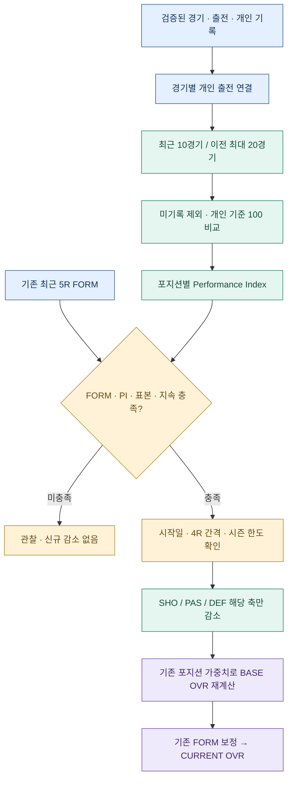

# GGFC V3.25.29 · Overview 랭킹·종합기록 이미지 개편

## 적용 내용

1. 첫째 줄을 출석랭킹 → 득점랭킹 → 도움랭킹으로 배치했습니다. 세 표의 소속 팀 열을 제거했습니다. 출석률 계산의 분모인 ‘팀 경기’ 열은 유지했습니다.
2. 둘째 줄을 팀순위 → 개인순위 → 파울순위로 배치했습니다. 작은 모바일 화면에서는 같은 순서로 세로 배치합니다. 종합기록 이미지는 화면 크기와 관계없이 3열×2행으로 출력합니다.
3. 세 랭킹은 최대 20명까지 표시하며, 남은 대상 선수가 있을 때만 20번째 선수 이름 뒤에 ‘외 N명’을 표시합니다. N은 동점 인원이 아니라 해당 랭킹의 20명 외 전체 대상 인원입니다. 20명 이하면 문구를 표시하지 않습니다.
4. 관리자 로그인 시 최신 경기 기록 시즌의 하반기 전체를 랭킹·상대전적의 기본 조회기간으로 적용합니다. 로그인 후 직접 선택한 기간은 일반적인 화면 갱신이나 동일 인증 상태 갱신으로 초기화하지 않습니다. 재로그인하면 하반기 전체로 돌아갑니다. 기간을 바꾸면 실제 선택 범위에 맞춰 안내문도 바뀝니다.
5. 기존 누적 팀순위의 주석을 첫째 줄 랭킹 위의 별도 안내 상자로 이동했습니다. 주석은 기존대로 관리자 화면에 표시하며, 기간 표시는 회원도 볼 수 있습니다. 예: ‘2026년 하반기 전체 라운드 누적 기록 · 1R~11R · 132경기 · 등록된 경기 기준’. 아직 열리지 않은 미래 라운드의 성적이 포함된다는 뜻은 아닙니다. 이미지에도 집계 기준과 조회기간을 표시합니다.
6. 이미지의 구간 팀순위와 누적 팀순위 상자를 짙은 남색 테두리로 강조하고, 1위 행에 금색 배경과 왕관을 적용했습니다. 누적 팀순위의 공동 1위는 모두 왕관을 표시합니다. 순위 계산식 자체는 그대로입니다.

## 랭킹 계산 기준

| 항목 | 대상 | 정렬 | 외 N명 |
|---|---|---|---|
| 출석랭킹 | 조회기간에 참가 가능한 팀 경기가 있는 선수 | 출석률 내림차순 → 이름순; 동일 출석률 공동순위 | 대상 선수 수 − 20 |
| 득점랭킹 | 조회기간 득점 1개 이상 | 득점 내림차순 → 출전 경기 수 오름차순 → 이름순 | 득점 대상 선수 수 − 20 |
| 도움랭킹 | 조회기간 도움 1개 이상 | 도움 내림차순 → 출전 경기 수 오름차순 → 이름순 | 도움 대상 선수 수 − 20 |

‘외 N명’은 0보다 클 때만 표시합니다. 도움은 기존 검증된 경기기록의 도움 합계(`a`)를 사용하며 키패스를 도움으로 변환하지 않습니다. 선수 이름 클릭 시 기존과 동일한 조회기간의 선수카드가 열립니다.

기존 상단 ‘팀 순위 및 누적 기록’의 구간 조회는 하단 랭킹 조회와 독립적으로 유지됩니다. 관리자 기본 하반기 조회에 기록이 없으면 빈 표가 표시됩니다. 열람모드의 랭킹은 기존대로 최신 경기의 해당 반기 기준입니다.

## 유지한 V3.25.28 변경

- 각 대진에 슈퍼리그·챌린지리그·인터리그 등 경기 구분 표시
- 모든 출력 표 제목 행의 짙은 남색·흰색 굵은 글씨
- PNG 기본 2568×12282px, 캔버스 생성 실패 시 1712×8188px로 재시도
- 원본 로고 종횡비 유지, 출력 전용 배치로 일반 화면에 영향 방지

## 파일 적용

V3.25.27 또는 V3.25.28 사용자는 `ggfc-record_V3.25.29_UPDATE_FROM_3.25.27_OR_28.zip`의 6개 파일을 동일 경로에 덮어쓰면 됩니다.

- `index.html`
- `mobile.html`
- `assets/ggfc-app.js`
- `assets/ggfc.css`
- `assets/ggfc-export.css`
- `README.md`

전체 33개 파일은 `ggfc-record_V3.25.29_LIGHT_FULL_33files.zip`에 들어 있습니다. 기존 프로젝트의 Firebase 설정은 보존하세요. `firebase-config.js`, `database.rules.json`, `assets/ggfc-sync.js`, `assets/ggfc-slump.js` 등 나머지 파일은 기존 V3.25.27과 동일합니다.

교체 후 강력 새로고침(Ctrl+Shift+R)을 실행하고 상단 V3.25.29 표기를 확인하세요. 운영 GitHub/Firebase에는 자동 배포하지 않았습니다.

## 검증

실제 통합 기록지(경기 282개, 참석 4106행)를 사용했습니다. 기본 하반기 기준 출석 대상 66명/득점 대상 57명/도움 대상 38명으로 ‘외 46명/37명/18명’을 확인했습니다. 0·19·20·21·23명 경계, 조회기간 전환·재로그인, 상단 팀순위 독립 유지, 화면과 출력 수치 일치, 왕관, 2568×12282px 저장, 출력 영역 잘림 여부, 모바일 가로 넘침 및 브라우저 오류를 확인했습니다. 계산 DB와 기존 능력치·SLUMP 엔진은 변경하지 않았습니다.

---

아래는 이전 V3.25.27 운영 안내입니다. 아래 버전명과 당시 배포 파일명은 이전 변경 이력입니다.

# GGFC V3.25.27 · LONG FORM / SLUMP 구현·운영 보고서

작성 기준: V3.25.26 최종 Full, 「붙여넣은 텍스트(1).txt」 요구사항, DB GGFC_통합_기록지_역대기록(4).xlsx.

## 먼저 확인할 운영 사항

**요청한 기본 설정을 유지하면 신규 SLUMP 감점은 발생하지 않습니다.** 구현 오류가 아니라 기존 FORM 산식과 지속 조건의 조합에 따른 결과입니다.

기존 FORM의 최근 5R 중 4R 연속 출전 시 출석 가산은 최소 +0.8입니다. 경기성과 최솟값은 −1.5이고 연속결석 벌점은 0이므로 원점수 최솟값은 `+0.8−1.5=−0.7`, 반올림한 FORM은 **−1**입니다. 따라서 **FORM ≤−2 AND 출전 4R 연속**은 기본 FORM에서 충족할 수 없습니다. 본 버전은 결석을 부진 지속의 증거로 세지 않는 보수적인 구현입니다.

- 기본값 −2와 기존 FORM 계산은 그대로 보존했습니다.
- 관리자에서 FORM Trigger를 **−1**로 변경할 수 있습니다. 이 경우에도 PI≤75, 표본, 출전 4R 지속, 개별 축 기준을 모두 충족해야 감점합니다. −1이 곧바로 감점을 뜻하지 않습니다.
- 이번 파일의 기본값을 임의로 −1로 바꾸지 않았습니다. 우선 비교 지표와 자료 충실도를 확인하는 용도로 사용할 수 있습니다.
- 신규 적용 시작일 기본값은 **2026-10-20**입니다. 시작일 이전 기존 LONG FORM 조정은 유지하고, 이후 기존 방식과 새 방식을 중첩하지 않습니다.
- 회복 Story는 기본 **OFF**입니다. 부진 내용을 회원 Story로 강제 노출하지 않습니다.

## 1. 버전과 수정 파일

| 항목 | 내용 |
|---|---|
| 이전 버전 | V3.25.26, 그대로 보존 |
| 새 버전 | V3.25.27 |
| 전체 ZIP | `ggfc-record_V3.25.27_LIGHT_FULL_33files.zip` · 33개 파일 |
| 교체 ZIP | `ggfc-record_V3.25.27_UPDATE_FROM_3.25.26.zip` · 6개 파일 |
| 배포 여부 | 파일 생성·로컬 검증 완료. GitHub/Firebase 운영 서버 미배포 |

| 파일 | 변경 내용 |
|---|---|
| `assets/ggfc-slump.js` | 신규 계산 엔진, 검증 기록 연결, 카드/설정/안내/회복 Story |
| `assets/ggfc-app.js` | 기본 설정, 능력치 재계산 연결, 이전 이력 보존, 설정 저장·검증 |
| `assets/ggfc.css` | SLUMP 요약·관리자 표, 모바일 저장 버튼과 하단 메뉴 겹침 방지 |
| `index.html` | 신규 모듈 로드, 버전·설명 갱신 |
| `mobile.html` | 동일 모바일 연결 |
| `README.md` | 적용 순서 및 운영·계산·검증 안내 |

`firebase-config.js`, `database.rules.json`과 기존 SoccerBee·BEST 5·커플·DUO 산식은 변경하지 않았습니다. 새 모듈은 기존 경기와 능력치를 재사용하며 외부 의존성을 추가하지 않습니다.

## 2. 적용 방법

1. 현재 V3.25.26 파일과 관리자의 JSON DB 백업을 보관합니다.
2. V3.25.26 사용자: 교체 ZIP을 풀어 파일 6개를 동일 경로에 올립니다. **새 `assets/ggfc-slump.js`도 반드시 업로드**합니다.
3. 다른 버전이거나 전체 파일이 필요하면 Full을 사용합니다. 운영 중인 `firebase-config.js`와 `database.rules.json`은 유지합니다.
4. 강력 새로고침 후 화면의 V3.25.27을 확인합니다.
5. 관리자 → 선수 능력치 설정 → **LONG FORM / SLUMP · 개인 경기력**에서 시작일과 기준을 확인하고 **능력치 설정 저장**을 누릅니다.
6. 선수카드를 열어 SLUMP 요약과 관리자 비교 상세를 확인합니다. 저장은 기존 공유 DB 경로를 사용합니다.

상단 메뉴·사이드바 접힘·메뉴 공개/이름/순서/첫 화면 기능은 V3.25.26 구성을 유지합니다.

## 3. 전체 계산 구조



새 Performance에 팀 승패·개인파울·필드 출전시간을 직접 넣지 않습니다. 기존 FORM에는 기존 승패·개인파울·출석 효과가 그대로 남습니다. 두 계산은 분리되어 있습니다.

## 4. 출전 경기와 R의 구분

| 단위 | 의미 |
|---|---|
| 출전 1경기 | 검증된 대진 한 경기에서 선수1~15 명단 또는 허용된 양수 활동 기록으로 확인된 참여 |
| 1R | 기존 FORM과 같은 선수의 경기일. 같은 날 4경기 출전하면 표본은 4경기, 지속 판정은 1R |
| Recent | 해당 시점까지 최근 출전 10경기 |
| Baseline | Recent 바로 이전 최대 20경기, 최소 10경기 필요 |

동일 날짜 내 경기는 경기번호·라운드·고유 경기 키 순으로 정렬합니다. 같은 날짜의 모든 기록을 모은 뒤 R 판정을 한 번 수행합니다. 충돌 경기·중복 대진은 기존 검증 목록으로 처리합니다. 몰수 경기는 실제 출전 표본에서 제외합니다. 양 팀 참여가 충돌한 선수도 제외합니다.

공식 출석 명단이 빠져도 골·도움·MOM·유효슛·키패스·수비성공·선방의 양수 기록과 연결이 확인되면 분석용 참여 근거로 사용할 수 있습니다. **이 기능이 공식 참석수나 출석 가산을 새로 부여하지는 않습니다.**

결석한 날에는 최근 출전 창에 가짜 0기록을 넣지 않습니다. 그날은 신규 감점하지 않고 `PAUSED`로 표시합니다. 지속/회복 연속 횟수는 끊습니다. 이후 새 실제 출전 기록으로 다시 연속 판정합니다.

## 5. 경기당 기록과 100점 기준

```text
경기당 기록 = 해당 비교기간 기록 합계 / 해당 비교기간 실제 출전 경기 수
Performance = 최근 경기당 기록 / 과거 경기당 기록 × 100
최종 지표 = 50~120 범위로 제한
```

| 조건 | 지표 |
|---|---:|
| 과거 0, 최근 0 | 100 |
| 과거 0, 최근 양수 | 120 |
| 과거 양수, 최근 0 | 50 |
| 과거 0.50골/경기, 최근 0.35골/경기 | 70 |
| 자료 누락 또는 확인 불가 | N/A · 제외 |

필드 계산에는 분당·15분당·시간 보정이 없습니다. 드리블 성공·턴오버·수비블록은 DB에 있어도 새 엔진에서 읽지 않습니다.

## 6. 누락 자료와 부분 데이터

미기록을 0으로 바꾸지 않습니다. **최근 또는 과거 구간에 한 경기라도 값이 미확인인 지표는 해당 지표 전체를 비교에서 제외**합니다. 기록된 경기만으로 분모를 줄여 비교하지 않습니다. 남은 지표 가중치를 재분배하고 `부분 데이터 기반`으로 표시합니다.

- 골: 해당 팀의 득점자 합계가 팀 득점과 맞는 경기만 사용합니다. 합계가 맞으면 해당 선수의 득점 명단 부재는 0골로 봅니다.
- 도움: 해당 경기·팀에 도움 기록이 있거나 팀 득점이 0인 경우만 0을 판단할 수 있습니다. 빈 도움 칸과 실제 무도움은 기존 DB에서 구별할 수 없어 그 외는 N/A로 처리합니다.
- 유효슛·키패스·수비성공: 연결된 팀별 기록지의 명시 숫자만 사용합니다. 입력 `0`은 유효, 빈칸은 N/A입니다.
- MOM: 확인된 수상 횟수만 보너스로 사용합니다. 미수상을 감점 근거로 삼지 않습니다.
- 포지션 불명 또는 모든 사용 지표가 N/A이면 `INSUFFICIENT DATA`, 감소 없음입니다.

예: 과거 유효슛이 누락됐지만 골 기록이 모두 확인되면 SHOOTING은 골 100%로 임시 계산합니다. 수비성공이 누락됐으면 DEF 감소를 만들지 않습니다.

## 7. 축·포지션별 가중치

| Index | 구성 |
|---|---|
| SHOOTING | 골 Performance 60% + 유효슛 Performance 40% |
| PASSING | 도움 Performance 50% + 키패스 Performance 50% |
| DEFENSIVE | 수비성공 Performance 100% |

| 포지션 | SHOOTING | PASSING | DEFENSIVE |
|---|---:|---:|---:|
| PV / PIVO | 55% | 30% | 15% |
| AL / ALA | 35% | 35% | 30% |
| FS / FIXO | 15% | 25% | 60% |

선수명단의 해당 연도 포지션을 기존 OVR 시스템과 동일하게 읽습니다. 종합 PI에는 Recent의 MOM 1회당 +3, 최대 +6을 더하고 120을 상한으로 합니다. MOM은 개별 Index를 올리지 않습니다. 위 가중치는 **Performance 가중치**이며 기존 능력치 OVR 가중치와 다릅니다.

## 8. 상태·확정·감소량

| 종합 PI | 관찰 상태 |
|---|---|
| 85 이상 | NORMAL |
| 75 초과 ~ 85 미만 | WATCH |
| 70 이상 ~ 75 이하 | SLUMP |
| 60 이상 ~ 70 미만 | SEVERE SLUMP |
| 60 미만 | CRITICAL SLUMP |

소수점에 빈 구간이 생기지 않도록 연속 범위로 판정합니다. 위 관찰 상태는 감점 확정을 의미하지 않습니다.

**CONFIRMED SLUMP 기본 조건 — 모두 충족:**

1. 현재 FORM ≤ −2.
2. 종합 PI ≤ 75.
3. Recent 실제 출전 10경기와 Baseline 최소 10경기 확보.
4. 같은 조건이 실제 출전한 경기일에서 4R 연속 지속.
5. 적용 시작일 이후. 지속 횟수도 시작일 이후부터 누적.

처음 확정한 R에서 한 번 적용하고, 이후 최소 4R 간격을 둡니다. 조건이 끊어지면 다시 4R 연속을 확인합니다. 각 날짜는 한 번만 판정합니다.

| 해당 개별 Index | 해당 축의 1회 감소 |
|---|---:|
| 70 이상 ~ 75 이하 | −0.20 능력치 |
| 60 이상 ~ 70 미만 | −0.35 능력치 |
| 60 미만 | −0.50 능력치 |
| 기준 초과 또는 N/A | 0 |

Overall이 낮아도 개별 Index가 정상인 축은 감소하지 않습니다. `SHOOTING→SHO`, `PASSING→PAS`, `DEFENSIVE→DEF`; **PAC·DRI·PHY는 신규 SLUMP 감소 대상이 아닙니다.** 기존 SoccerBee 변화나 기존 결석 처리가 이 세 축에 미치는 효과는 유지됩니다.

예: 확정 상태에서 SHO Index=65, PAS=82, DEF=91이면 SHO만 −0.35입니다. PV의 기존 SHO OVR 가중치가 0.25라면 직접 OVR 영향은 `0.35×0.25=0.0875`입니다. −0.35 OVR를 직접 빼는 것이 아닙니다.

## 9. GK 전용 판정

```text
SAVE % = 합산 선방 / (합산 선방 + 합산 실점) × 100
GA / 15 = 합산 실점 / 합산 GK 시간 × 15
GK PI = SAVE% Performance × 70% + GA/15 Performance × 30%
```

SAVE%는 최근/과거 비율, GA/15는 **과거/최근 비율**로 평가합니다. 각 비교 지표는 50~120 범위입니다. GA/15가 과거·최근 모두 0이면 100, 최근만 0이면 120, 과거만 0이면 50입니다.

- 최근 10회와 이전 최대 20회는 GK 수행기록이 확인된 출전만 사용합니다. 일반 필드 출전은 GK 표본에 넣지 않습니다.
- 선방+실점=0이면 SAVE%=N/A입니다. 100% 선방률로 만들지 않습니다.
- 선방은 팀별 기록지 우선의 기존 `playerSaveRows` 연결 규칙을 사용합니다. 키퍼실점을 선방으로 읽거나 중복 합산하지 않습니다.
- 팀 실점과 키퍼 실점 합계가 불일치한 수행기록은 새 SLUMP 지표에서 제외합니다.
- 누락 지표는 재분배하되 모든 지표를 사용할 수 없으면 감소하지 않습니다.
- GK도 FORM·표본·지속·간격·시즌 한도 조건을 모두 적용하고 **DEF만** 감소합니다. 필드 MOM 보너스는 GK PI에 중복 적용하지 않습니다.

## 10. 시즌 한도·중복 방지·회복

### 한도

각 감소 이벤트에서 해당 연도 포지션 가중치를 정규화하여 `Σ(실제 축 감소×OVR 가중치)`를 계산합니다. 연간 1~12월 합계 최대 **1.5 OVR**입니다. 마지막 이벤트가 잔여 한도를 초과하면 축별 감소량을 같은 비율로 줄입니다. 능력치 최솟값도 지킵니다.

기존 결석·파울·SoccerBee·이전 LONG FORM 감소는 신규 SLUMP 한도에 합산하지 않습니다. 이후 성장률 구간이나 상한 효과 때문에 ON/OFF의 장기 BASE 차이는 이벤트 직접 영향 합계와 다를 수 있습니다. 한도는 **SLUMP 이벤트의 직접 영향**을 제한합니다.

### 중복 방지

고유 ID는 `[SLUMP-v1, 선수명, 경기일]`입니다. 원본 능력치에 감점 이벤트를 저장·덧붙이지 않고 매번 원본부터 날짜순으로 재생합니다. 한 재생 중 같은 ID를 다시 적용하지 않습니다. 새로고침이나 다른 화면 조회, Firebase 동기화가 추가 차감을 만들지 않습니다.

조회 기준일 이후 자료는 사용하지 않습니다. 과거 기록 정정이나 설정 변경은 해당 이력을 다시 계산합니다.

### 회복

종합 PI ≥85가 실제 출전 경기일 3R 연속이면 RECOVERED입니다. 그전에 감점 조건이 깨져도 추가 감소는 즉시 중단됩니다. 이미 감소한 능력치를 자동 가산하지 않습니다. 기존 성장 로직으로 이후 회복합니다. 회복 Story ON일 때만 `PERFORMANCE RECOVERY`를 표시합니다.

## 11. 관리자 설정·DB·이전 버전 처리

| 설정 | 기본값 | 허용 범위 |
|---|---:|---|
| SLUMP SYSTEM | ON | ON/OFF |
| 적용 시작일 | 2026-10-20 | 유효 날짜 |
| Recent Games | 10 | 10~50 정수 |
| Baseline Games | 20 | 10~100 정수 |
| Minimum Baseline Games | 10 | 10~100 정수, 최대값 이하 |
| FORM Trigger | −2 | −5~−1 정수 |
| Performance Trigger | 75 | 50~75 |
| Persistence Rounds | 4 | 4~20 정수 |
| Decay Interval | 4 | 4~20 정수 |
| Recovery Performance | 85 | 85~120 |
| Recovery Rounds | 3 | 3~20 정수 |
| SLUMP / SEVERE / CRITICAL 감소 | 0.20 / 0.35 / 0.50 | 0~2, 단계가 심할수록 감소량 유지/증가 |
| Season Decay Cap | 1.5 OVR | 0~1.5 |
| 회복 Story | OFF | ON/OFF |

설정은 `DB.settings.ability.config.slump`에 보관합니다. **경기기록·Excel 신규 열은 없습니다.** 동적 지표·상태·이벤트는 파생값이며 DB에 별도 누적 저장하지 않습니다. 기존 `longForm` 설정은 시작일 이전 이력 재현용으로 유지합니다.

이전 V3.25.26 LONG FORM을 시작일 전에만 계산하므로 기존 BASE가 배포 시점에 갑자기 복원되거나 추가 감소하지 않습니다. 새 OFF는 신규 SLUMP만 중단합니다. 시작일을 과거로 변경하면 기존/신규 판정 경계도 바뀌므로 전체 이력이 재계산됩니다.

사용자가 수정한 기존 성장·SoccerBee·FORM·OVR 가중치를 유지합니다. 메뉴 공개 설정 및 JSON 백업·복원·Firebase 직렬화도 유지합니다. Firebase 보안 규칙이나 인증 방식은 변경하지 않았습니다.

## 12. 화면 구성

- Player Card: BASE / CURRENT / FORM / PERFORMANCE 요약, SLUMP 상태, 부분 데이터 안내.
- Player Ratings: 기존 BASE 위치와 모바일 선수 목록에 SLUMP 상태 표시.
- 관리자 카드 토글: Recent/Baseline 경기 수, 경기당 골·도움·유효슛·키패스·수비성공, 각 Index, Overall, FORM, 지속/회복 R, 최근 Event ID, 시즌 합계, 축별 이벤트 내역.
- GK 관리자 카드: SAVE%와 GA/15 비교.
- 기존 Player Ratings 설명과 능력치 운영 안내: 새 계산 기준으로 교체.
- Record Stories: 기본 숨김. 설정 ON 시 회복 내용을 긍정적인 문구로 표시.
- PC 카드의 좁은 영역에서도 요약 숫자가 겹치지 않도록 2×2 배치. 상세 표는 토글 안에서 가로 이동.
- 모바일 능력치 설정의 저장 버튼이 하단 메뉴에 가려지지 않도록 수정.

## 13. 검증 결과와 범위

### 실제 DB 비교

| 항목 | 결과 |
|---|---|
| 경기 | 282경기 |
| 공식 참석 데이터 | 4,106건 |
| 능력치 비교 선수 | 66명 |
| 최신 경기일 | 2026-10-16 |
| 이전 버전과 BASE·CURRENT·FORM·누적 결과 | 66명 모두 일치 |
| 과거 신규 SLUMP 이벤트 | 0건 |
| 이전 방식 조정 이력이 있는 선수 | 8명, 기존 영향 유지 |
| Performance 계산 가능 | 61명 |
| 부분 데이터 | 66명, 누락 지표 제외 |
| PI ≤75 | 25명이나 감점 확정 아님 |
| 명단 GR 선수 | 4명 모두 GK 비교 표본 부족 |

진단용으로 시작일만 2026-01-01로 옮겨 실행한 별도 메모리 테스트에서도 기본 FORM/지속 조건을 충족한 신규 감점은 0건이었습니다. 이 설정을 배포 파일이나 운영 DB에 저장하지 않았습니다.

확인된 GK 원자료 불일치: **2026-10-16, 11R-A / 5경기, F킬러 — 팀 실점 3골 / 입력 `안진오2(15)`의 키퍼실점 2골.** 신규 SLUMP는 이 수행기록의 비율을 감점 근거로 쓰지 않습니다. Excel 원본은 수정하지 않았습니다.

### 계산·회귀 검증

계산 엔진 24항목, 실제 DB/브라우저 28항목, 추가 수치 회귀·통합 9항목, 최종 UI 3항목으로 **총 64항목**을 통과했습니다.

- 요청 CASE 1~12: 일시 부진, 확정 감점, 축별 분리, FIXO 0골, 장기 결석, 제외 기록, 필드 시간 미사용, GK, 회복, 자동복원 없음, 10회 재조회, 신규 선수 보호.
- 추가: 0분모·범위 제한, MOM 상한, 미기록 재분배, 포지션 불명, 시작일, 간격, 시즌/연도 전환, 능력치 하한, OFF, 설정 오류 차단.
- 통합 이벤트 fixture: 실제 기록 연결 경로에 40경기를 넣고 **FORM 입력만 −3으로 고정한 테스트**에서 고유 이벤트 4건, 10회 재조회 일치, 과거 조회 미래 이벤트 배제, PAC/DRI/PHY 보존을 확인했습니다. 기본 FORM으로도 감점이 생긴다는 의미가 아닙니다.
- 실제 DB 기준 베스트커플 3명, DUO 1조, BEST 5 전체·슈퍼·챌린지 결과를 이전 버전과 수치 비교했습니다.
- 실제 통합 DB에 SoccerBee 측정값이 없으므로 부분 측정·재측정 fixture를 추가하여 이전 버전과 수치 비교했습니다. 실제 회원의 별도 SoccerBee 파일 전체를 검증했다는 의미는 아닙니다.
- Overview, Player Stats, Ratings, Squad, BEST 5, Analysis/Chemistry, Stories, Maker, All-Time Records, GK 화면 렌더링과 카드·관리자 설정을 확인했습니다.
- Firebase 설정 split/merge 보존을 검증했습니다. 운영 서버 저장·다중 사용자 실시간 전송은 수행하지 않았습니다.
- PC 1440px, 모바일 390px에서 카드·설정 화면과 문서 가로 넘침, 저장 버튼 접근을 확인했습니다. 브라우저 스크립트 오류 0건입니다.
- 전체 JS `node --check` 및 Full/교체 ZIP 무결성 검사를 통과했습니다.

현재 데이터의 부분 기록과 기본 FORM Gate 제약을 감안하면, 먼저 관리자 상세의 기록 충실도를 확인한 뒤 FORM 기준 변경 여부를 결정하는 운영이 적합합니다.
